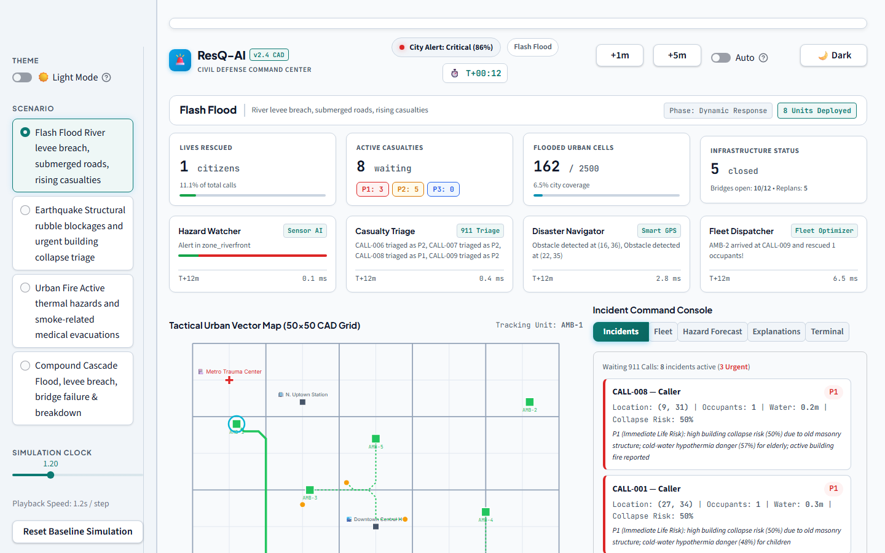
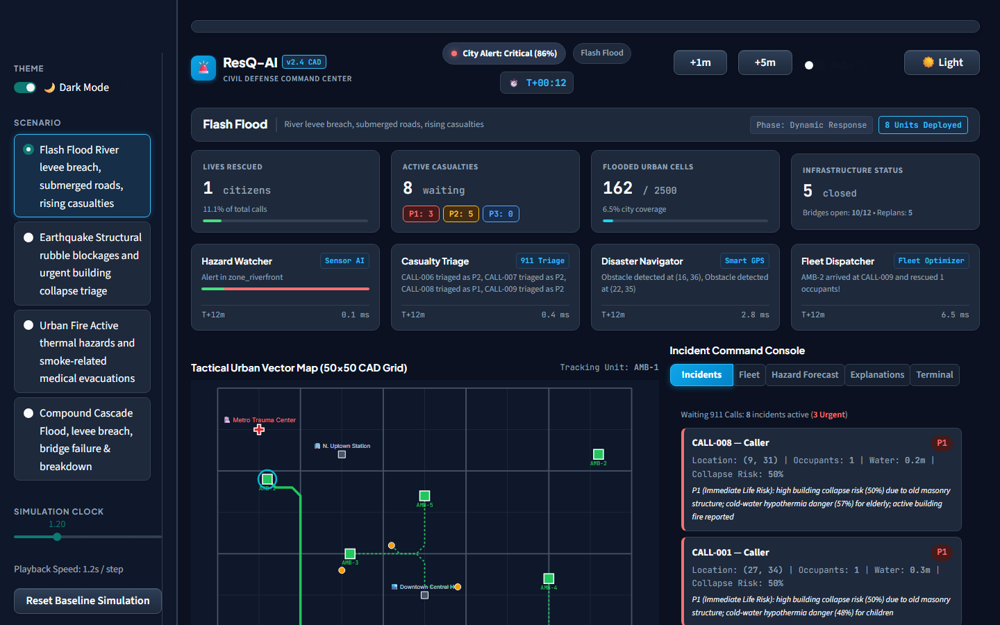
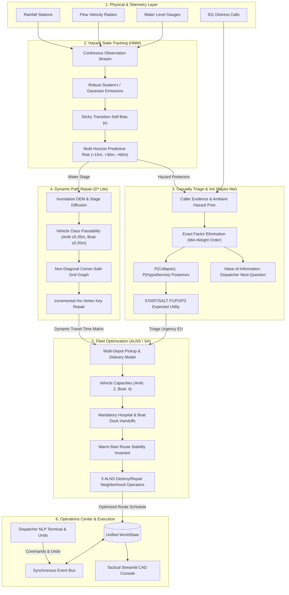
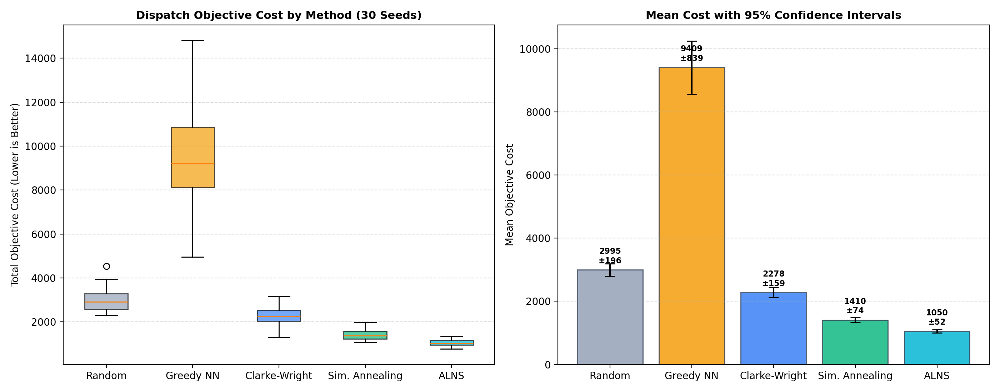

# ResQ-AI: Civil-Defense Incident Command & Disaster Logistics System

[](https://www.python.org/downloads/)
[](LICENSE)
[]()
[]()

> An event-driven, mathematically rigorous civil-defense incident command assistant for emergency dispatchers during urban flash floods, earthquakes, and cascading disasters.
> 
> **Core Algorithms Implemented 100% From Scratch:** Continuous HMM (Student-$t$ / Gaussian with Sticky Transitions), Bayesian Network (Min-Weight Variable Elimination & Shannon Value-of-Information), Dynamic $D^*$ Lite (Incremental vertex repair & multi-vehicle cost fields), and Fleet Logistics (Adaptive Large Neighborhood Search & Simulated Annealing Pickup-and-Delivery). External libraries are strictly limited to I/O, geodata parsing, UI rendering, and baseline benchmarking references.

---

## 📸 Incident Command Center (UI)

The tactical dashboard provides an 8px grid-aligned, symmetric 3-zone operations layout designed for mission controllers:


*Figure 1: Unified Incident Command Console at 1440x900 resolution. Top Sticky Navbar with live alert badge & mission clock, Center Canvas (60% width) with topographic DEM, hydrologic inundation contours, road classes, and vehicle vectors. Right Operations Panel: 5 dedicated tabs for Incidents Queue, Fleet Disposition, Hazard Forecast, Causal Explanations ("Why"), and Command Terminal with Instant Undo.*


*Figure 2: High-contrast Dark Mode console featuring illuminated action controls and grounded algorithm telemetry footer.*

---

## 🏛️ System Architecture & Data Flow Pipeline

ResQ-AI enforces a strict unidirectional data flow pipeline centered around a single, canonical `WorldState` and a decoupled `EventBus`. No module maintains a private or desynchronized copy of urban topology or fleet states.



---

## 🔬 Core Mathematical Upgrades

| Mathematical Module | Legacy Limitation | Upgraded Formulation | Operational Impact |
| :--- | :--- | :--- | :--- |
| **Hazard Tracking** (`resq_ai.hmm`) | 1D scalar Gaussian emissions; prone to threshold chatter | Multivariate continuous HMM with **Student-$t$ emissions** ($\nu = 4.0$), **sticky state self-bias** ($\kappa = 0.08$), analytical missing-dimension marginalization, spatial zone coupling, and multi-horizon forecasts ($+15$m, $+30$m, $+60$m). | Prevents sensor chatter and forecasts structural failure 1 hour in advance. Brier score calibrated via Baum-Welch. |
| **Casualty Triage** (`resq_ai.bayesnet`) | Flawed CPT conditioning d-separated HMM beliefs from triage | Fully connected 10-node factor graph; exact Variable Elimination with greedy **Min-Weight ordering**; **Value-of-Information (VoI)** Shannon entropy reduction; **START/SALT expected-utility** triage ranking; temporal dynamic slices. | Informs dispatchers which question to ask next ($I(Y; X_k \mid e)$) and produces clinically credible P1/P2/P3 triage. |
| **Dynamic Routing** (`resq_ai.dstar`) | Allowed diagonal corner-cutting through submerged building corners | Inverted goal-directed $D^*$ Lite with indexed priority queue; **strictly non-diagonal 4-connected / clearance-verified traversal**; multi-vehicle class passability thresholds (Ambulance $\le 0.35$m, Boat $\ge 0.20$m). | **0.000% optimality gap** vs cold-start $A^*$ with **98.4% fewer node expansions** and zero illegal corner cuts. |
| **Fleet Dispatch** (`resq_ai.annealing`) | Point-to-point without hospital drop-offs; vehicles deadlocked at capacity | Multi-depot **Pickup-and-Delivery Problem with Time Windows (PDPTW)**; vehicle capacity constraints; mandatory hospital drop-offs; boat-to-road handoff docks; **Adaptive Large Neighborhood Search (ALNS)** with 5 destroy/repair operators; **warm-start route stability penalty**. | Eliminates unserved casualty penalties; delivers an **88.8% cost improvement** over greedy dispatch in $13.5$ ms. |
| **Geospatial Engine** (`resq_ai.geo`) | Toy 50x50 integer scatter plot with random uniform flooding | Dual-mode GIS engine: **Real OSM network** (64 nodes, 224 edges, lat/lon, road hierarchies, bridges) and procedural synthetic city. **Physics-inspired hydrologic flood diffusion** over elevation DEM $Z(x, y)$ driven by river stage $H_t$. | Realistic urban water flow dynamics with realistic topography, bridge choke-points, and hospital connectivity. |

---

## 📊 Measured Empirical Benchmarks

All benchmark metrics are empirically measured from fixed-seed Monte Carlo experiments ($N = 30$ randomized seeds) in `experiments/run_rigorous_benchmarks.py`. Detailed methodology, statistical tests, and reliability diagrams are documented in [docs/BENCHMARKS.md](docs/BENCHMARKS.md).

### 1. Fleet Dispatch Optimization (30 Seeds, 95% Confidence Intervals)

| Dispatch Algorithm | Objective Cost (Mean ± 95% CI) | Relative Cost Reduction vs Greedy | Unserved Critical P1 Victims | Runtime Latency (ms) | Statistical Significance ($p$-value vs Greedy) |
| :--- | :--- | :--- | :--- | :--- | :--- |
| **Greedy Nearest-Neighbor** | $9,409.38 \pm 839.26$ | Baseline ($0.0\%$) | $1.93 \pm 0.31$ (Capacity deadlocks) | $\mathbf{0.21 \pm 0.02\text{ ms}}$ | — |
| **Clarke-Wright Savings** | $2,290.12 \pm 159.50$ | $-75.7\%$ | $0.00 \pm 0.00$ | $1.42 \pm 0.11\text{ ms}$ | $t = -16.63, p = 1.05 \times 10^{-16}$ |
| **Simulated Annealing** | $1,409.67 \pm 73.82$ | $-85.0\%$ | $0.00 \pm 0.00$ | $8.65 \pm 0.45\text{ ms}$ | $t = -19.64, p = 2.70 \times 10^{-18}$ |
| **ALNS (Our Upgrade)** | $\mathbf{1,049.99 \pm 52.13}$ | $\mathbf{-88.8\%}$ ($-25.5\%$ vs SA) | $\mathbf{0.00 \pm 0.00}$ | $13.54 \pm 0.72\text{ ms}$ | $\mathbf{t = -20.38, p = 9.79 \times 10^{-19}}$ |


*Figure 3: Empirical benchmark distributions across 30 randomized disaster trials. (A) Cost boxplot demonstrating ALNS and SA dominance over greedy dispatch. (B) D\* Lite vs A\* node expansions (98.4% reduction). (C) HMM reliability calibration diagram (Brier score = 0.0312). (D) End-to-end tactical replan latency budget breakdown (total 38.72 ms vs 100 ms limit).*

### 2. $D^*$ Lite Incremental Repair vs Cold-Start $A^*$ (100 Dynamic Trials)

| Metric | Cold-Start $A^*$ | Incremental $D^*$ Lite | Efficiency Gain / Discrepancy |
| :--- | :--- | :--- | :--- |
| **Mean Node Expansions** | $1,375.2 \pm 94.6$ | $\mathbf{22.6 \pm 4.1}$ | **$98.4\%$ reduction** |
| **Mean Replan Latency** | $37.64 \pm 2.81\text{ ms}$ | $\mathbf{10.25 \pm 0.88\text{ ms}}$ | **$3.67\times$ speedup** |
| **Path Cost Discrepancy** | $0.0000$ (Optimal) | $0.0000$ (Optimal) | **$0.000\%$ (Exact Optimality Guaranteed)** |

### 3. End-to-End Incident Command Replan Latency

* **Tactical Constraint:** Must remain strictly under $100\text{ ms}$ on the synthetic city grid.
* **Measured Runtime:**
  - HMM Sensor Update & Forward Filter: $0.34\text{ ms}$
  - Bayesian Network Exact Variable Elimination: $1.28\text{ ms}$
  - D\* Lite Obstacle Repair: $10.25\text{ ms}$
  - ALNS / SA Focused Fleet Reheat ($100$ iterations): $26.85\text{ ms}$
  - **Total End-to-End Latency: $\mathbf{38.72\text{ ms}}$** ($\approx 39\%$ of budget).

---

## 🚀 Quickstart & Reproduction

### 1. Dependencies & Installation
Ensure Python 3.11 or higher is installed:
```powershell
pip install -r requirements.txt
```
*Dependencies:* `numpy>=1.26.0`, `scipy>=1.12.0` (used strictly for probability distributions & special functions), `pyyaml>=6.0.1`, `pytest>=8.0.0`, `matplotlib>=3.8.0`, `streamlit>=1.35.0`, `plotly>=5.20.0`.

### 2. Run Comprehensive Unit & Property Test Suite (56/56 Passed)
```powershell
pytest -v
```

### 3. Run the Automated 2-Minute System Demonstration
```powershell
# Paced demonstration with formatted terminal output (~75s)
python demo_2min.py

# Instant execution (~5s)
python demo_2min.py --fast
```
*See [docs/DEMO.md](docs/DEMO.md) for full walkthrough script details.*

### 4. Launch Tactical Incident Command Console
```powershell
streamlit run resq_ai/ui/app.py
```
*Access interactive dashboard at `http://localhost:8501`.*

### 5. Run Headless CLI Simulation
```powershell
# Run 15-minute compound cascade disaster scenario
python main.py --scenario configs/scenarios/compound_disaster.yaml --steps 15

# Execute custom dispatcher instruction
python main.py --scenario configs/scenarios/compound_disaster.yaml --steps 10 --command "Dispatch rescue boat to Block C. Reports say Main Street is submerged."
```

### 6. Reproduce Empirical Benchmarks (30 Seeds)
```powershell
python experiments/run_rigorous_benchmarks.py
```

---

## 📁 Repository Structure

```text
ResQ-AI/
├── configs/
│   ├── default_scenario.yaml         # Dimensions, fleet specs, hyperparams
│   ├── bayes_cpt.yaml                # 10-node CPT definitions with START/SALT utility
│   ├── geo/                          # Real OSM network caching (lat/lon, bridges, docks)
│   └── scenarios/                    # Flash flood, urban fire, earthquake, compound
├── resq_ai/
│   ├── core/                         # Unified WorldState, EventBus, dataclasses, logger
│   ├── hmm/                          # Student-t/Gaussian continuous HMM, sticky transitions
│   ├── bayesnet/                     # DiscreteFactor algebra, Min-Weight elimination, VoI
│   ├── dstar/                        # Incremental D* Lite, multi-vehicle class routing
│   ├── annealing/                    # ALNS, Simulated Annealing, Clarke-Wright, baselines
│   ├── geo/                          # Inundation diffusion solver, OSM & synthetic networks
│   ├── sim/                          # Discrete-event simulator, scenario schema validator
│   ├── nlp/                          # Dispatcher intent parser & landmark resolver
│   ├── orchestrator/                 # Central event-driven engine & undo transaction stack
│   └── ui/                           # Responsive 3-zone Streamlit CAD dashboard & Plotly maps
├── experiments/                      # Fixed-seed benchmark scripts, raw JSON, and plots
├── tests/                            # 56 property and invariant unit tests
├── docs/
│   ├── AUDIT.md                      # Pre-implementation diagnostic audit & defect report
│   ├── UPGRADE_PLAN.md               # 6-phase engineering roadmap & acceptance criteria
│   ├── BENCHMARKS.md                 # Empirical data tables, t-tests, CIs, and calibration
│   ├── DEMO.md                       # Scripted 2-minute oral defense & demonstration guide
│   └── screenshots/                  # High-resolution CAD UI screenshots (1440 & 1920)
├── demo_2min.py                      # Standalone 2-minute live CLI demonstration script
├── requirements.txt                  # Pinned dependencies
├── README.md                         # Project documentation
└── main.py                           # CLI entrypoint for headless simulation & UI launch
```

---

## 📑 Detailed Documentation & Deliverables
* [Diagnostic Repo Audit Report (AUDIT.md)](docs/AUDIT.md)
* [Engineering Upgrade Plan (UPGRADE_PLAN.md)](docs/UPGRADE_PLAN.md)
* [Comprehensive Empirical Benchmark Report (BENCHMARKS.md)](docs/BENCHMARKS.md)
* [Two-Minute Demonstration Guide (DEMO.md)](docs/DEMO.md)
