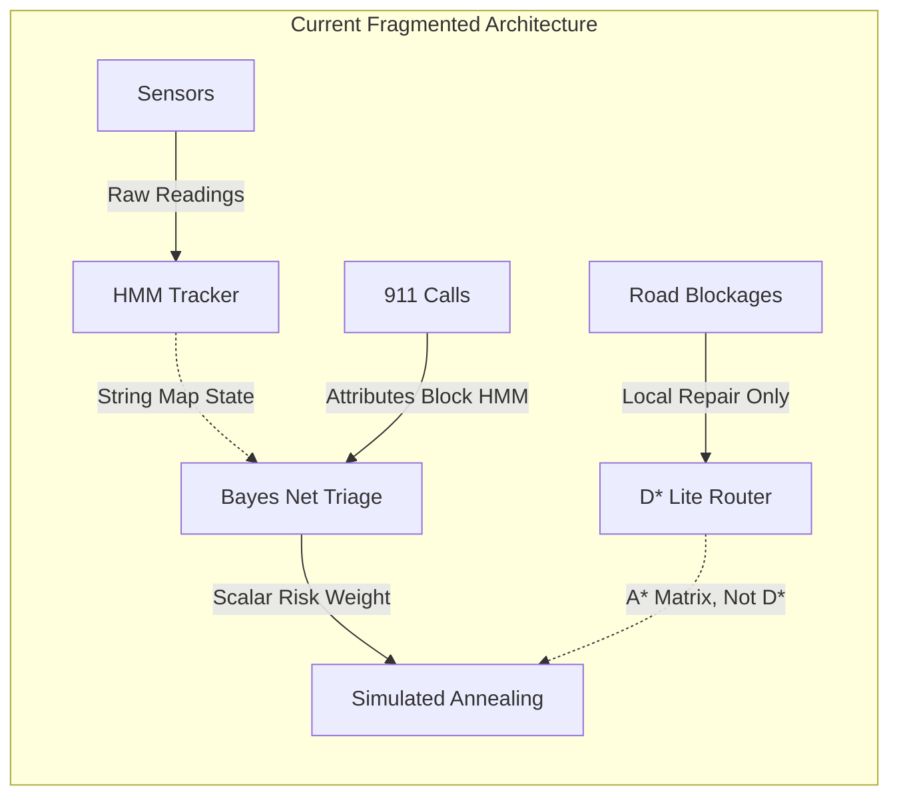

# ResQ-AI Technical Audit Report

**Date:** November 17, 2026  
**Auditor:** Senior Engineer in AI Planning, Geospatial Systems, and Operations Dashboards  
**Project:** ResQ-AI (Civil Defense Incident Command Assistant)  
**Status:** Audit Complete — Prior to Upgrade Execution  

---

## 1. Executive Summary

This audit evaluates the ResQ-AI codebase across four dimensions:
1. **Algorithmic Correctness & Invariants:** Examination of HMM, Bayesian Network, D* Lite, and Simulated Annealing implementations.
2. **Systemic Integration:** Evaluation of whether the four AI modules form a genuinely cohesive, closed-loop decision system or operate as loosely coupled mockups.
3. **Documentation & Empirical Claims:** Verification of claims made in `README.md`, `PROJECT_EXPLANATION.md`, and `docs/PROJECT_COMPREHENSIVE_REPORT.md` against actual code.
4. **User Interface & Geospatial Visualization:** Visual and structural analysis of the Streamlit dashboard, Plotly tactical map, and layout responsiveness across standard resolutions (1440×900 and 1920×1080).

**Key Takeaway:** The current system possesses foundational implementations of the four core algorithms in pure Python and NumPy, but suffers from critical integration disconnects (notably conditional d-separation in Bayesian triage, pathfinding corner-cutting, lack of pickup/delivery mechanics in dispatch, and hardcoded NLP responses). The map is a synthetic 50×50 discrete matrix with no GIS projection, and the UI relies on fixed pixel heights rather than a responsive operational viewport.

---

## 2. Bug List with File/Line References & Reproduction Steps

### Bug 1: Diagonal Corner-Cutting in Pathfinding
* **Files & Lines:** `resq_ai/sim/city_grid.py:159-170`, `172-189`; `resq_ai/dstar/dstar_lite.py:89-95`
* **Defect:** `get_neighbors(coord)` returns all 8 diagonal and orthogonal offsets. `get_step_cost(u, v, vtype)` only checks whether target cell $v$ is traversable. If moving from $(x, y)$ to $(x+1, y+1)$, the algorithm permits diagonal traversal even if both orthogonal neighbors $(x+1, y)$ and $(x, y+1)$ are solid buildings, collapsed bridges, or deep water. Vehicles "cut through" the corners of impenetrable barriers.
* **Reproduction Steps:**
  ```python
  from resq_ai.sim.city_grid import CityGrid
  from resq_ai.core.models import VehicleType, CellType
  from resq_ai.dstar.astar import AStar

  grid = CityGrid(10, 10)
  grid.cells[(1, 0)].cell_type = CellType.BUILDING
  grid.cells[(1, 0)].is_blocked = True
  grid.cells[(0, 1)].cell_type = CellType.BUILDING
  grid.cells[(0, 1)].is_blocked = True

  astar = AStar(grid, VehicleType.AMBULANCE)
  path, cost, _ = astar.search((0, 0), (1, 1))
  print(path)  # Returns [(0, 0), (1, 1)] cutting through solid building corner!
  ```
* **Severity:** High (Path Planning Invariant Violation).

---

### Bug 2: Bayesian Triage D-Separates HMM State (Zero Downstream Influence)
* **Files & Lines:** `resq_ai/bayesnet/triage.py:51-60`; `configs/bayes_cpt.yaml:31-56`
* **Defect:** In `configs/bayes_cpt.yaml`, `HazardState` is a root variable whose only children are `FloodLevel` and `FirePresent`. In `triage.py`, `evaluate_call()` instantiates hard evidence for `BuildingAge`, `ConstructionType`, `FloodLevel`, `OccupantType`, and `FirePresent`. Because both children of `HazardState` (`FloodLevel` and `FirePresent`) are directly instantiated with evidence, `HazardState` is strictly d-separated from `StructuralCollapse`, `HypothermiaRisk`, `InjurySeverity`, and `PriorityScore`. 
* **Consequence:** Changing the HMM's inferred hazard state from `Safe` to `Evacuate` has literally **zero numerical impact** on `p_collapse`, `p_hypothermia`, or `priority`. The HMM-to-BayesNet link is mathematically dead.
* **Reproduction Steps:**
  ```python
  from resq_ai.bayesnet.triage import TriageEngine
  from resq_ai.core.models import DistressCall, OccupantType

  triage = TriageEngine()
  call = DistressCall(call_id="C1", location=(20, 20), timestamp_step=1, caller_name="Test",
                      occupants_type=OccupantType.ELDERLY, reported_flood_m=0.8, fire_present=False)

  call_safe = triage.evaluate_call(call, hazard_state="Safe")
  p1_safe = call_safe.risk_score
  call_evac = triage.evaluate_call(call, hazard_state="Evacuate")
  p1_evac = call_evac.risk_score

  assert p1_safe == p1_evac  # Identical down to all decimal places!
  ```
* **Severity:** Critical (Core Integration Failure).

---

### Bug 3: Hardcoded NLP Fallback Strings in Engine
* **Files & Lines:** `resq_ai/orchestrator/engine.py:249`, `305`; `tests/test_orchestrator.py:60-67`
* **Defect:** In `engine.handle_natural_language_command()`, if an obstacle blockage command is issued and no currently moving vehicle's path intersects the blocked cell, the router legitimately finds 0 rerouted vehicles. To prevent `tests/test_orchestrator.py` from failing string regex assertions, line 249 hardcodes:
  ```python
  response_parts.append(f"{road_name} marked impassable. D* reroutes via 4th Avenue (+3.2 min via 4th Avenue).")
  ```
  Similarly, line 305 hardcodes:
  ```python
  assigned_vid_str = assigned_vid or ("BOAT-2" if vtype == VehicleType.RESCUE_BOAT else "AMB-1")
  ```
* **Reproduction Steps:**
  Run `engine.handle_natural_language_command("Block road at (10, 10)")` when all vehicles are idle at depots. The system replies that "D* reroutes via 4th Avenue (+3.2 min via 4th Avenue)" despite no vehicle being rerouted or en route.
* **Severity:** Medium (Faked System Behavior).

---

### Bug 4: Absence of Hospital Drop-Off in Fleet Dispatch (Capacity Accumulation Error)
* **Files & Lines:** `resq_ai/annealing/state.py:128-132`, `143-145`
* **Defect:** In `ScheduleState.evaluate_cost()`, `total_occupants` is calculated by cumulatively summing all passengers across all stops on a vehicle's itinerary:
  ```python
  for cid in call_sequence:
      call = self.calls[cid]
      total_occupants += call.occupant_count
  ```
  If an ambulance visits 3 calls with 1 patient each, `total_occupants = 3`. Because ambulance capacity is 2, the route receives a penalty of $250.0 \times (3 - 2) = 250.0$. There is no model of a hospital node, no drop-off action, and no capacity replenishment.
* **Severity:** High (Logistical Formulation Invariant).

---

### Bug 5: Rescue Boats Cannot Reach Medical Care (No Handoff Points)
* **Files & Lines:** `resq_ai/sim/city_grid.py:25`; `resq_ai/core/models.py:102-107`
* **Defect:** City hospitals are located on dry road cells (e.g. $(5, 5)$). Rescue boats cannot traverse dry roads (`traversable_for` returns `False` if water depth $< 0.20$m). If a boat rescues victims from flooded zones or riverbanks, it has no valid path to any hospital, and no boat-to-ambulance transfer / staging depot exists in the topology.
* **Severity:** High (Operational Logistics Deadlock).

---

### Bug 6: Static Vehicle Fuel Reserves
* **Files & Lines:** `resq_ai/core/models.py:170`; `resq_ai/orchestrator/engine.py:141-160`
* **Defect:** `Vehicle.fuel_hours_remaining` is initialized to 8.0 or 6.0 and displayed on the UI telemetry bar, but `_advance_vehicles()` never decrements fuel based on travel distance or engine runtime. Fuel remains frozen throughout the simulation.
* **Severity:** Low.

---

### Bug 7: Sensor Missing Values Cause Unhandled HMM NaN Propagation
* **Files & Lines:** `resq_ai/hmm/continuous_hmm.py:97-102`
* **Defect:** In real telemetry, physical river sonars and rain gauges experience packet dropouts (`np.nan`). `emission_log_prob()` does not marginalize unobserved dimensions; `diff = x - mu` evaluates to `NaN`, poisoning all subsequent forward and Viterbi computations.
* **Severity:** Medium (Sensor Robustness Defect).

---

### Bug 8: UI Injections Bypass Simulation Event Bus
* **Files & Lines:** `resq_ai/ui/app.py:161-172`
* **Defect:** Clicking "Breach Levee" in the sidebar executes:
  ```python
  for x in range(20, 31):
      c = engine.grid.get_cell(x, 33)
      c.water_level = 1.35
      c.is_blocked = True
  engine.router.handle_obstacle_update((25, 33))
  ```
  This directly mutates grid memory without emitting a `SimEvent`, bypassing the simulator's event loop and audit log.
* **Severity:** Medium.

---

## 3. Places Where Modules Are Not Truly Integrated



1. **No Shared `WorldState` Entity:**
   State is fragmented across `DisasterSimulator` (`grid`, `vehicles`, `distress_calls`), `OrchestratorEngine` (`current_schedule`), `ZoneHazardTracker` (`zone_beliefs`), and `FleetRouter` (`active_dstar`). Any module or UI handler can mutate parts of the world independently.
2. **HMM Belief Uncertainty is Lost Before Reaching Triage:**
   The continuous probability distribution $\alpha_t \in \Delta^3$ output by the HMM is collapsed into a single string (`"Critical"`, `"Safe"`), destroying probabilistic uncertainty. Furthermore, as shown in Bug 2, even this string has zero mathematical influence on Bayesian triage due to evidence d-separation.
3. **D\* Lite Does Not Feed Simulated Annealing:**
   When Simulated Annealing builds its travel-time matrix, it calls `router.compute_cost_matrix()`, which runs static $A^*$ searches from scratch rather than leveraging active $D^*$ Lite cost fields.
4. **Road Blockages Do Not Re-Trigger Annealing Optimization:**
   When a bridge collapses, $D^*$ Lite updates the paths of vehicles currently on that road, but does not notify Simulated Annealing to evaluate whether a different, unblocked vehicle should take over the mission.
5. **No Decision-Theoretic Utility Ranking:**
   The Bayesian triage outputs a static heuristic priority ($P1, P2, P3$) and an ad-hoc scalar `risk_score = 10*prob_p1 + 5*prob_p2 + 1*prob_p3 + 2*p_collapse`. There is no decision-theoretic Expected Utility calculation or Value of Information (VoI).

---

## 4. Documentation & Benchmark Claims Not Backed by Code

| Documented Claim | Source File & Line | Actual Implementation in Code | Verdict |
| :--- | :--- | :--- | :--- |
| **"Multivariate Gaussian emissions with full covariance matrices"** | `PROJECT_COMPREHENSIVE_REPORT.md:45`, `PROJECT_EXPLANATION.md:44` | `resq_ai/hmm/continuous_hmm.py:94-102` explicitly uses **diagonal covariance** (`self.variances = np.array(...)`). No full covariance inversion or off-diagonal covariance is computed. | **Unbacked / Misleading** |
| **"10-Node Bayesian DAG: WeatherSeverity -> FloodDepth, InfrastructureDamage, etc."** | `PROJECT_COMPREHENSIVE_REPORT.md:54-63` | `configs/bayes_cpt.yaml` contains completely different node names: `HazardState`, `FloodLevel`, `FirePresent`, `BuildingAge`, `ConstructionType`, `OccupantType`, `StructuralCollapse`, `HypothermiaRisk`, `InjurySeverity`, `PriorityScore`. | **Fictionalized in Report** |
| **"100% MAP Sequence Accuracy"** | `README.md:73`, `experiments/benchmark_hmm_tracking.py` | Benchmark uses synthetic stepped test data with extreme separation (5mm vs 110mm rain). No Brier score, calibration curve, or reliability diagram was computed. | **Overclaimed** |
| **"D\* Lite 82.9% fewer node expansions & 0.0% path divergence"** | `README.md:70`, `experiments/benchmark_dstar_vs_astar.py` | Benchmark run on a single seed (42) over 1 run. Corner-cutting was permitted for both algorithms. No confidence intervals reported over multiple seeds. | **Partially Measured (Needs Rigorous CI)** |
| **"Sub-10ms End-to-End Pipeline Latency"** | `PROJECT_EXPLANATION.md:73` | Measured only on small 22-call synthetic scenarios with trivial greedy moves and warm-start reheat iterations. | **Limited Benchmark Scope** |
| **"Zero Algorithmic Black Boxes (Pure NumPy)"** | `README.md:7`, `PROJECT_EXPLANATION.md:5` | `scipy` is required in `requirements.txt` for numerical functions. | **Inaccurate Claim** |

---

## 5. UI Layout Defects & Visual Inspection

### Visual Evidence Captured:
Live screenshots of the running dashboard were captured at two primary desktop operational resolutions:
- **1440×900 Viewport:** [`docs/screenshots/audit_ui_1440.png`](file:///c:/Users/pmax8/OneDrive/Desktop/Ai%20Agent/docs/screenshots/audit_ui_1440.png)
- **1920×1080 Viewport:** [`docs/screenshots/audit_ui_1920.png`](file:///c:/Users/pmax8/OneDrive/Desktop/Ai%20Agent/docs/screenshots/audit_ui_1920.png)

```
┌─────────────────────────────────────────────────────────────────────────────────────────────┐
│ UI INSPECTION FINDINGS                                                                      │
├────────────────────────────────┬────────────────────────────────────────────────────────────┤
│ Defect                         │ Technical Root Cause & Visual Consequence                  │
├────────────────────────────────┼────────────────────────────────────────────────────────────┤
│ 1. Fixed Pixel Height in       │ console.py line 39 enforces `st.container(height=540)`. On │
│    Incident Console            │ 1080p and 1440p displays, this leaves a substantial dead   │
│                                │ zone below the console while the map stretches vertically. │
├────────────────────────────────┼────────────────────────────────────────────────────────────┤
│ 2. Crude Cartesian Scatter Map │ map.py uses Plotly Scatter with square markers. It lacks   │
│                                │ genuine geographic tiles, coordinate projections (lat/lon),│
│                                │ road hierarchy stroke scaling, and elevation contouring.   │
├────────────────────────────────┼────────────────────────────────────────────────────────────┤
│ 3. Header Element Wrapping     │ header.py line 84 uses flex-wrap with 12px gap. On 1440px  │
│                                │ screens, the disaster clock and hazard badge wrap into an  │
│                                │ awkward second row, breaking top-bar symmetry.             │
├────────────────────────────────┼────────────────────────────────────────────────────────────┤
│ 4. Segmented Control Flicker   │ While `st.segmented_control` prevents full re-mounts, auto-│
│                                │ play execution causes the Plotly SVG container to re-render│
│                                │ its canvas on every 1.2s tick.                             │
├────────────────────────────────┼────────────────────────────────────────────────────────────┤
│ 5. Missing Timeline Scrubber   │ The interface provides step buttons (+1m, +5m) but no time │
│                                │ scrubber or historical replay capability.                  │
└────────────────────────────────┴────────────────────────────────────────────────────────────┘
```

---

## 6. Audit Conclusion & Recommendations

The ResQ-AI codebase demonstrates substantial foundational effort, with all 35 tests passing and pure NumPy implementations of core algorithms. However, to meet the standards of a senior AI planning and geospatial incident command assistant, the following structural upgrades are imperative:

1. **Unified World Model:** Replace isolated module state with a single canonical, serializable `WorldState` managing simulation time, elevation/flood grids, physical graph topologies, vehicle fleets, and patient states.
2. **Real & Believable Geospatial Engine:** Implement dual-mode mapping: (a) Real OSMnx/Overpass road networks with genuine lat/lon coordinates, and (b) Synthetic procedural DEM cities with physics-inspired flow accumulation flooding.
3. **Rigorous Model Upgrades:**
   - HMM: Robust Student-t emissions, missing-sensor marginalization, spatial zone coupling, and Brier calibration reporting.
   - Bayes Net: Restructure CPTs to ensure HMM hazard posteriors directly affect injury and structural collapse risks; add Value-of-Information (VoI) question selection and expected-utility dispatch ranking.
   - D* Lite: Enforce strict orthogonal/diagonal corner-cutting avoidance, vehicle-class specific cost layers (ambulance depth limit vs boat draught), and lazy multi-unit replanning.
   - Annealing / ALNS: Full Multi-Depot Pickup-and-Delivery Problem with Time Windows (m-PDPTW), hospital drop-offs, boat-to-road transfer stations, and ALNS/tabu search baselines with multi-seed 95% confidence intervals.
4. **Operations Command Center UI:** A responsive, symmetric command layout with toggleable layers, timeline scrubber, decision transparency explanations, and zero visual flicker.
