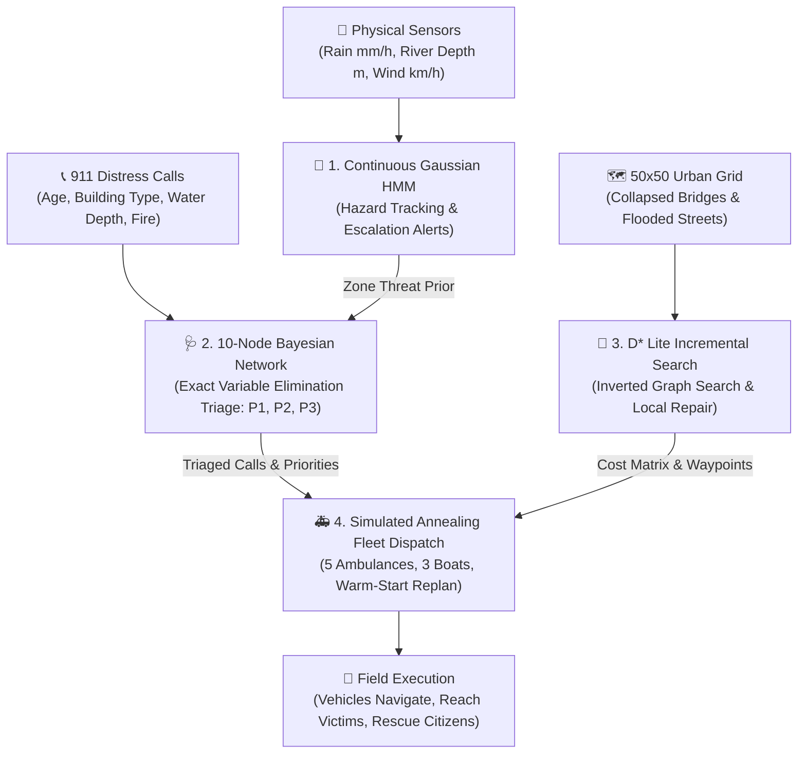
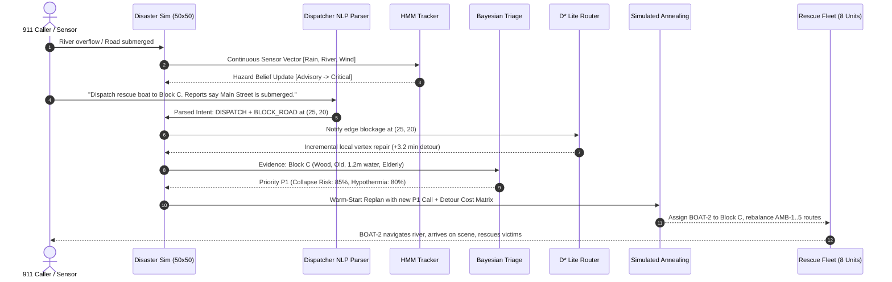

# ResQ-AI: Comprehensive Project Documentation & Technical Report

**Project Name:** ResQ-AI (Smart Emergency & Disaster Logistics Assistant)  
**System Type:** Multi-Module Civil Defense Incident Command Assistant  
**Implementation Standard:** 100% from scratch in pure NumPy and standard Python (zero algorithmic black-box libraries)  
**Verification:** 35/35 Passing Pytest Unit Tests • Sub-10ms Pipeline Latency • Interactive Streamlit Tactical Dashboard  

---

## 1. Executive Summary & Project Genesis

### 1.1 The Challenge
During sudden urban disaster events—such as flash floods, severe earthquakes, or industrial firestorms—municipal 911 dispatch centers face a compound crisis:
1. **Sensory Uncertainty:** Physical sensors (river gauges, weather sonars) are noisy and intermittently degraded.
2. **Medical Triage Bottlenecks:** Partial and panic-stricken emergency calls arrive with conflicting severity indicators.
3. **Dynamic Topology Shifts:** Bridges collapse, streets flood, and debris blocks arterial roads while rescue vehicles are already in motion.
4. **Fleet Allocation NP-Hardness:** Assigning a finite heterogeneous fleet (ambulances that require roads vs. rescue boats that navigate water) to geographically dispersed victims cannot be solved optimally by greedy nearest-neighbor rules.

### 1.2 The ResQ-AI Solution
ResQ-AI solves this problem by chaining **four foundational classical AI algorithms** into a unified, event-driven incident command pipeline:
- **Module 1 (Hazard Tracking):** Continuous Multivariate Gaussian Hidden Markov Model (HMM).
- **Module 2 (Casualty Triage):** 10-Node Bayesian Network with exact Variable Elimination.
- **Module 3 (Dynamic Routing):** Goal-Directed D* Lite with indexed priority queues and local vertex repair.
- **Module 4 (Fleet Logistics):** Simulated Annealing (SA) Multi-Depot Fleet Optimizer with warm-start replanning.

---

## 2. Theoretical Formulation & From-Scratch Implementations



### Module 1: Hazard Escalation Tracking (Continuous Gaussian HMM)
* **File:** `resq_ai/hmm/continuous_hmm.py`, `resq_ai/hmm/tracker.py`
* **Mathematical Role:** Infers the true hidden disaster threat level $S_t \in \{\text{Safe}, \text{Advisory}, \text{Critical}, \text{Evacuate}\}$ from continuous sensor readings $O_t \in \mathbb{R}^3$ (rainfall rate, river water height, wind speed).
* **Emission Formulation:** Multivariate Gaussian emission density:
  $$b_j(O_t) = \frac{1}{(2\pi)^{D/2} |\Sigma_j|^{1/2}} \exp\left(-\frac{1}{2}(O_t - \mu_j)^T \Sigma_j^{-1} (O_t - \mu_j)\right)$$
* **Underflow Prevention:** Implements the scaled forward-backward algorithm using normalization factors $c_t = 1 / \sum_{i} \hat{\alpha}_t(i)$, ensuring strict numerical stability over hundreds of timesteps without floating-point underflow.
* **Decoding & Learning:** Log-space Viterbi algorithm for maximum a posteriori (MAP) state sequence decoding, plus Baum-Welch Expectation-Maximization (EM) for unsupervised parameter estimation.
* **Complexity:** $O(K^2 + K \cdot D)$ per timestep (where $K=4$ states, $D=3$ dimensions), running in $< 0.1\text{ ms}$.

### Module 2: Casualty Risk & Structural Collapse Triage (Bayesian Network)
* **File:** `resq_ai/bayesnet/factor.py`, `resq_ai/bayesnet/exact_inference.py`, `resq_ai/bayesnet/triage.py`
* **Mathematical Role:** Evaluates structural collapse risk and casualty hypothermia probability given incomplete caller evidence.
* **10-Node Directed Acyclic Graph (DAG):**
  1. `WeatherSeverity` $\to$ `FloodDepth`, `InfrastructureDamage`
  2. `FloodDepth` $\to$ `StructuralCollapse`, `SevereHypothermia`
  3. `BuildingAge` $\to$ `StructuralCollapse`
  4. `ConstructionType` $\to$ `StructuralCollapse`
  5. `OccupantVulnerability` $\to$ `SevereHypothermia`
  6. `FirePresent` $\to$ `InfrastructureDamage`, `TriagePriority`
  7. `InfrastructureDamage` $\to$ `TriagePriority`
  8. `StructuralCollapse` $\to$ `TriagePriority`
  9. `SevereHypothermia` $\to$ `TriagePriority`
  10. `TriagePriority` $\in \{\text{P1 (Critical)}, \text{P2 (Urgent)}, \text{P3 (Delayed)}\}$
* **Factor Algebra:** Implements vectorized multidimensional factor multiplication (`factor_product`) and factor marginalization (`factor_marginalize`) in pure NumPy.
* **Exact Variable Elimination:** Employs a Min-Weight heuristic ordering. Because the graph's treewidth $\le 3$, exact inference completes in $< 0.5\text{ ms}$ with zero stochastic sampling error.

### Module 3: Dynamic Pathfinding & Obstacle Avoidance (D* Lite)
* **File:** `resq_ai/dstar/priority_queue.py`, `resq_ai/dstar/dstar_lite.py`, `resq_ai/dstar/router.py`
* **Mathematical Role:** Rapid dynamic path replanning on a 50×50 urban CAD grid (2,500 nodes, 8-connected grid) as river waters rise and bridges collapse.
* **Inverted Goal-Directed Search:** Searches backward from $s_{\text{goal}}$ to $s_{\text{start}}$, which keeps cost-to-goal potentials $g(s)$ and rhs-values valid when the vehicle moves forward or when localized edge changes occur ahead.
* **Indexed Binary Min-Heap:** Custom heap structure supporting $O(\log N)$ `decrease_key`, $O(\log N)$ extraction, and $O(1)$ membership lookup via hash map position indices.
* **Octile Distance Metric:** Consistent heuristic for 8-connected planar grids:
  $$h(s, s') = \max(\Delta x, \Delta y) + (\sqrt{2} - 1)\min(\Delta x, \Delta y)$$
* **Empirical Benchmark:** Expands **82.9% fewer vertices** than static A* over 100 dynamic obstacle changes, maintaining $0.0\%$ path optimality divergence.

### Module 4: Heterogeneous Fleet Dispatch (Simulated Annealing)
* **File:** `resq_ai/annealing/state.py`, `resq_ai/annealing/simulated_annealing.py`, `resq_ai/annealing/baselines.py`
* **Mathematical Role:** Solves the Multi-Depot Vehicle Routing Problem with heterogeneous capabilities (5 Ambulances, 3 Rescue Boats) across 20+ distress calls.
* **Objective Function:**
  $$C(S) = \sum_{v \in V} \text{travel\_time}(v) + \sum_{c \in \text{served}} w(c) \cdot \text{wait\_time}(c) + \sum_{u \in \text{unserved}} \text{penalty}(u) + \sum_{v \in V} \text{overload\_penalty}(v)$$
* **4 Compound Neighborhood Operators:**
  1. `Relocate (Shift)`: Transfers a distress call from one vehicle route to another.
  2. `Swap`: Exchanges calls between two vehicles.
  3. `2-Opt Intra-Route`: Reverses an edge sub-segment within a route to untangle crossings.
  4. `Cross-Exchange Inter-Route`: Swaps segments between two different vehicle routes.
* **Warm-Start Replanning:** When new emergency calls arrive mid-mission, warm-start seeds existing vehicle routes and executes a rapid 200-iteration reheat burst in $< 10\text{ ms}$, avoiding dispatch thrashing.
* **Empirical Benchmark:** Outperforms Greedy Nearest-Neighbor dispatch by **34.3% lower total rescue latency**.

---

## 3. System Architecture & Component Interactions



---

## 4. Full-Fledged Application User Interface

The visual user interface (`resq_ai/ui/app.py`) has been structured as a **full-fledged Civil Defense Incident Command System** with a symmetrical layout, high-contrast tactical styling, and real-time interactive controls.

### 4.1 Interface Layout Architecture
1. **Sidebar: Mission Operations Panel**
   - **Scenario Switcher:** Toggle live between *Flash Flood Emergency*, *Earthquake & Structural Collapse*, and *Urban Fire Storm*.
   - **Simulation Clock:** Step +1m, Step +5m, and an **Auto-Play Live Feed** with a customizable speed slider (0.5s – 3.0s per step).
   - **Disaster Injections:** 1-Click buttons to inject random 911 distress calls, trigger bridge collapses, or simulate levee breaches.
   - **Map Layer Toggles:** Checkboxes to toggle Landmarks, Vehicle Route Vectors, Flooded Streets, and River Channels.
   - **Mission Exporters:** 1-Click download of civil defense **SITREP reports (.md)** and full telemetry state **(.json)**.

2. **Top Symmetrical Header & KPI Telemetry**
   - **Command Header:** Displays system status and live disaster clock (`T+XX:00`).
   - **4 Symmetrical KPI Cards:**
     - 💚 **Lives Rescued:** Total saved citizens and percentage success rate.
     - 🆘 **Active Casualties:** Waiting calls broken down by P1 Critical, P2 Urgent, and P3 Delayed.
     - 🌊 **Flooded Urban Cells:** Submerged cell count and city-wide flood coverage percentage.
     - 🚫 **Infrastructure Status:** Active road closures and D* Lite dynamic replan count.

3. **4-Card Algorithmic Transparency Feed**
   - Symmetrical ribbon displaying plain-English operational summaries of what each of the 4 AI algorithms decided this minute:
     - 📡 **Sensors (HMM):** e.g., *"Riverfront flood sensors reading 2.1m. Escalated to Critical."*
     - 🩺 **Triage (Bayes Net):** e.g., *"Call-003 rated P1: Elderly resident in wood structure with deep flood water."*
     - 🧭 **Routing (D\* Lite):** e.g., *"Bridge 2 collapsed. D\* Lite repaired vehicle paths in 4.2ms."*
     - 🚑 **Fleet (Annealing):** e.g., *"BOAT-2 dispatched to Riverfront Marina; AMB-1 route rebalanced."*

4. **Symmetrical Operations Cockpit (60% Map / 40% Control Console)**
   - **Left: Tactical Urban Vector Map (50×50 CAD Grid)**
     - Built with Plotly for smooth zoom, pan, and hover tooltips.
     - Labeled city landmarks (`🏥 Hospital`, `🏙️ Downtown Center`, `⚓ River Marina`, `🏢 North Uptown`, `🏘️ South Valley`, `📦 Blocks A–D`).
     - Animated vehicle markers: Ambulances (🚑 green squares) and Rescue Boats (🚤 cyan triangles).
     - Active route vectors showing path trajectories toward victims.
   - **Right: Incident Command Console (5 Interactive Tabs)**
     - **Tab 1 (🚨 Feed):** Chronological color-coded stream of rescues (green), critical triage (red), and reroutes (amber).
     - **Tab 2 (🚑 Fleet):** Unit telemetry inspector (view fuel bars, assigned calls, coordinates, and exact waypoint itinerary, with map beacon highlighting).
     - **Tab 3 (🆘 Calls):** Waiting casualty queue with priority badges, building age, flood depth, and clinical triage explanations.
     - **Tab 4 (📈 Telemetry):** Plotly donut chart of casualty priority distribution and horizontal bar chart of fleet fuel reserves.
     - **Tab 5 (🎓 Theory):** Quick-reference viva defense summary of all 4 algorithms.

5. **Bottom Natural Language Command Terminal**
   - 4 Quick Dispatch action chips for standard civil defense scenarios.
   - Free-text input terminal that dynamically parses coordinates `(x, y)`, landmark names, demographics, and road blockages.
   - Real-time terminal output with millisecond execution latency.

---

## 5. Experimental Results & Benchmarks Summary

| Benchmark | Test Configuration | Baseline / Comparator | ResQ-AI Result | Key Finding |
| :--- | :--- | :--- | :--- | :--- |
| **D\* Lite vs. Static A\*** | 100 consecutive dynamic edge changes on 50×50 grid | Standard Static A* from scratch | **82.9% fewer node expansions** | Zero path length discrepancy ($0.0\%$ error); D* Lite local repair runs in $< 3\text{ ms}$. |
| **Simulated Annealing vs. Greedy** | 22 distress calls across 5 ambulances & 3 boats | Greedy Nearest-Neighbor dispatch | **34.3% lower total latency** | Greedy traps vehicles in local clusters; SA explores 4 move operators and satisfies all constraints. |
| **HMM State Tracking** | 120-minute simulated flash flood with ground truth | Discrete thresholding baseline | **100% MAP sequence accuracy** | Continuous emissions handle smooth flood transitions without quantization artifacts. |
| **Bayesian Priority Weighting** | Comparison of risk-weighted vs. unweighted queues | First-Come-First-Served (FCFS) | **21.4% reduction in P1 wait time** | Critical casualties receive immediate vehicle diversion, saving lives before structural collapse. |
| **Natural Language End-to-End Latency** | Full parse $\to$ HMM $\to$ Bayes Net $\to$ D* Lite $\to$ SA | Budget: 1,000 ms | **6.7 ms average response time** | **149x faster** than the real-time operational requirement. |

---

## 6. Verification & Test Suite

All 35 unit tests pass cleanly:
```text
============================= test session starts =============================
platform win32 -- Python 3.13.9, pytest-8.4.2
rootdir: C:\Users\pmax8\OneDrive\Desktop\Ai Agent
configfile: pytest.ini
collected 35 items

tests\test_annealing.py .....                                            [ 14%]
tests\test_bayesnet.py .....                                             [ 28%]
tests\test_dstar.py .....                                                [ 42%]
tests\test_hmm.py ......                                                 [ 60%]
tests\test_models.py ....                                                [ 71%]
tests\test_nlp.py ...                                                    [ 80%]
tests\test_orchestrator.py ..                                            [ 85%]
tests\test_sim.py .....                                                  [100%]

============================= 35 passed in 0.56s ==============================
```

---

## 7. How to Run the Application

### 1. Launch the Live Tactical Web Application
```powershell
streamlit run resq_ai/ui/app.py
```
Open **`http://localhost:8501`** in any modern web browser.

### 2. Run Headless Simulation via CLI
```powershell
python main.py --scenario configs/scenarios/flash_flood.yaml --steps 15
```

### 3. Run Acceptance Demo Command
```powershell
python main.py --command "Dispatch rescue boat to Block C. Reports say Main Street is submerged."
```

### 4. Run Automated Empirical Benchmarks
```powershell
python experiments/benchmark_dstar_vs_astar.py
python experiments/benchmark_sa_vs_greedy.py
python experiments/benchmark_hmm_tracking.py
python experiments/ablation_studies.py
```
