# ResQ-AI Upgrade Plan & Implementation Roadmap

**System:** ResQ-AI (Civil Defense Incident Command Assistant)  
**Author:** Senior Engineer in AI Planning, Geospatial Systems, and Operations Dashboards  
**Target Architecture:** Unified WorldState • Dual-Mode Geospatial Engine (OSM + DEM Synthetic) • Upgraded Decision Models (HMM, BayesNet, D* Lite, ALNS/Annealing) • Discrete-Event Simulator • Responsive 3-Zone Command Cockpit  

---

## 1. Upgrade Phases & Scope

```mermaid
flowchart TD
    P1["Phase 1: Unified World Model & Event Bus<br/>• Single Canonical WorldState<br/>• Strict Sensor->HMM->BN->D*->SA Pipeline<br/>• Integration Invariant Tests"] --> P2["Phase 2: Real Geospatial & Inundation Engine<br/>• Dual Mode: Real OSMnx/Overpass + Synthetic DEM<br/>• Flow-Accumulation Inundation Physics<br/>• Multi-Layer Map (Vector/Mapbox) with Zero Clutter"]
    P2 --> P3["Phase 3: Mathematical & Algorithmic Upgrades<br/>• HMM: Student-t, Missing Dimension Marginalization, Spatial Coupling, Brier Calibration<br/>• BayesNet: Fix D-Separation, Value-of-Information (VoI), Utility Ranking<br/>• D* Lite: No Corner-Cutting, Multi-Vehicle Cost Fields, Exact A* Equivalence<br/>• Dispatch: Pickup-and-Delivery with Hospital Drop-off, Boat Handoffs, ALNS"]
    P3 --> P4["Phase 4: Discrete-Event Simulator & Scenario Validation<br/>• Schema-Validated YAML Scenarios<br/>• Deterministic Seedable Event Queue<br/>• Mid-Mission Injections & Unit Breakdown"]
    P4 --> P5["Phase 5: Responsive Incident Command Center (UI/API)<br/>• Symmetrical 3-Zone Layout (Top, Left Rail, Map, 5-Tab Console, Scrubber)<br/>• Plain-English Explanations ('Why') & Undo Terminal<br/>• SITREP & GeoJSON Exporters"]
    P5 --> P6["Phase 6: Quality, Benchmarking & Acceptance Demo<br/>• Property-Based Tests (35+ Unit + Invariant Tests)<br/>• Rigorous Benchmarks with 95% CI across 30+ Seeds<br/>• 2-Minute Demo Script & Updated Documentation"]
```

---

## 2. Detailed Phase Specifications

### Phase 1: Unified World Model & Integration Pipeline
* **Objective:** Eliminate state fragmentation and establish a single source of truth (`WorldState`) that all modules inspect and mutate via an event bus.
* **Key Components:**
  - `resq_ai/core/world_state.py`: Encapsulates simulation clock, road graph / spatial index, digital elevation model (DEM), water depth field, active distress calls, hospital and depot locations, vehicle states, and event history.
  - `resq_ai/core/event_bus.py`: Decoupled publisher-subscriber event pipeline supporting event logging, undo/redo state serialization, and transactional state transitions.
  - **Strict Pipeline Invariant:** Sensor observation $\to$ HMM posterior update $\to$ Zone hazard evidence injected into Bayes Net $\to$ Triage priority & risk score $\to$ D* Lite edge weight adjustment $\to$ Annealing cost matrix $\to$ Vehicle dispatch $\to$ Physical movement $\to$ WorldState update.
* **Acceptance Criteria:**
  - Integration test demonstrating that shifting a single zone's rainfall sensor reading dynamically alters the final vehicle dispatch assignment.
  - All private copies of the grid and fleet inside individual modules are removed.

---

### Phase 2: Real Geospatial & Inundation Engine
* **Objective:** Replace the toy 50×50 Cartesian scatter plot with an authentic geospatial layer supporting real geographic coordinates and physics-based inundation.
* **Key Components:**
  - `resq_ai/geo/city_network.py`: Dual-mode network loader:
    1. **Real Mode:** Ingests OpenStreetMap road networks (OSMnx/Overpass cached offline as GeoJSON/GraphML) with real lat/lon, road hierarchies (`motorway`, `primary`, `secondary`, `residential`), bridge spans, and designated civil defense infrastructure (hospitals, fire stations, boat docks).
    2. **Synthetic Mode:** Procedurally generates a believable urban landscape with arterial grid, collector streets, meandering river, elevation DEM, district boundaries, and elevation gradients.
  - `resq_ai/geo/inundation.py`: Physics-inspired hydrologic inundation model:
    - Uses elevation DEM + river stage water height.
    - Topographically driven flow accumulation / bathtub diffusion across low-lying terrain.
    - Per-cell water depth dynamically gates road edge passability based on vehicle chassis clearance (ambulance max 0.35m, rescue boat minimum draft 0.20m).
  - `resq_ai/ui/tactical_map.py`: High-performance vector rendering (deck.gl / MapLibre or Plotly Mapbox with raster tiles):
    - Independent toggleable layers: Base road network, flood depth heatmap, hazard zones, victims by priority, unit positions with heading vectors, planned vs. executed routes, collapsed bridges, and medical staging depots.
* **Acceptance Criteria:**
  - Supports loading both real-world GIS coordinates (e.g., Central River District) and synthetic seedable benchmarks.
  - Flood water flows strictly along elevation gradients rather than random scatter.

---

### Phase 3: Mathematical & Algorithmic Upgrades
* **Objective:** Upgrade all four core algorithms to research-grade standards from scratch in pure NumPy/Python.
* **3.1 Continuous HMM Upgrades (`resq_ai/hmm/`):**
  - **Sensor Dropout Handling:** Marginalize missing sensor dimensions in Gaussian emissions when sensor telemetry contains `NaN` values.
  - **Robust Emissions:** Add Student-t emission density option with heavy tails to resist outlier spikes.
  - **Spatial Coupling:** Couple adjacent zone HMM transition matrices: $P(X_{t+1}^{(z)} \mid X_t^{(z)}, X_t^{(\text{neighbors})})$.
  - **Calibration & Forecast:** Compute Brier calibration scores and reliability curves; output multi-horizon forecast probabilities for reaching `Critical`/`Evacuate` within 15, 30, and 60 minutes.
* **3.2 Bayesian Network Upgrades (`resq_ai/bayesnet/`):**
  - **Fix D-Separation:** Restructure DAG dependencies in `configs/bayes_cpt.yaml` so `HazardState` directly influences both `InfrastructureDamage` and `StructuralCollapse` under ambient disaster severity, ensuring HMM posterior updates strictly propagate to triage risk.
  - **Value of Information (VoI):** Compute mutual information / expected entropy reduction $I(Priority; X_k \mid \mathbf{e})$ to recommend the optimal question for the 911 dispatcher to ask next.
  - **Decision-Theoretic Utility Ranking:** Implement Expected Utility ranking:
    $$EU(a) = \sum_{s} P(s \mid \mathbf{e}) \cdot U(a, s)$$
    aligned with standardized emergency triage protocols (START / SALT).
* **3.3 D\* Lite Incremental Pathfinding (`resq_ai/dstar/`):**
  - **Corner-Cutting Prevention:** Enforce strict diagonal transit clearance: a diagonal move $(x, y) \to (x+1, y+1)$ is valid if and only if both $(x+1, y)$ and $(x, y+1)$ are passable.
  - **Vehicle-Class Cost Layers:** Maintain distinct cost graphs for Ambulances (penalized by water depth, impassable $>0.35$m) and Rescue Boats (confined to river channels and water $\ge 0.20$m).
  - **A\* Equivalence Invariant:** Invariant tests verifying $0.0\%$ path optimality discrepancy between dynamic $D^*$ Lite and cold-start $A^*$ on every graph alteration.
* **3.4 Simulated Annealing & Fleet Dispatch (`resq_ai/annealing/`):**
  - **Multi-Depot Pickup-and-Delivery Problem with Time Windows (m-PDPTW):**
    - Ambulances pick up victims up to vehicle capacity, transport to hospital depots, drop off victims, and return to service.
    - Rescue boats pick up water-bound victims and transport them to designated **Boat-to-Road Handoff Docks**, where waiting ambulances transfer them to hospitals.
  - **Adaptive Large Neighborhood Search (ALNS):** Implement destroy operators (random removal, worst-cost removal, relatedness removal) and repair operators (greedy insertion, regret-2 insertion).
  - **Warm-Start Stability Penalty:** Penalize route deviations for units already en route to active emergency scenes to prevent dispatch thrashing.
  - **Statistical Baseline Benchmarks:** Run 30+ randomized seeds comparing ALNS/SA against Nearest-Neighbor and Clarke-Wright Savings, reporting mean, standard deviation, and 95% confidence intervals.
* **Acceptance Criteria:**
  - 100% mathematical consistency without diagonal corner cutting.
  - Zero capacity accumulation bugs: ambulances perform realistic hospital drop-offs.
  - Statistically verified $\ge 25\%$ latency reduction over baseline with 95% confidence intervals.

---

### Phase 4: Discrete-Event Simulator & Scenario Validation
* **Objective:** Build a deterministic, seedable discrete-event simulation engine with validated scenario profiles.
* **Key Components:**
  - `resq_ai/sim/simulator.py`: Priority queue discrete event loop processing scheduled time events and ad-hoc dispatcher interventions.
  - `resq_ai/sim/scenario_schema.py`: Pydantic/YAML schema validator ensuring disaster parameters, fleet counts, and infrastructure failure probabilities are strictly validated upon scenario load.
  - Mid-mission incident injections: Bridge structural collapse, sudden levee breaches, vehicle mechanical breakdowns, and mass-casualty call bursts.
* **Acceptance Criteria:**
  - Running a scenario twice with the same seed produces bit-identical telemetry and event logs.

---

### Phase 5: Responsive Incident Command Center (UI / API)
* **Objective:** Replace fixed-height cluttered elements with an incident command cockpit matching modern civil defense standards.
* **Key Components:**
  - **Symmetrical 3-Zone Operations Layout:**
    1. **Top Bar:** Scenario selector, mission clock ($T+\text{HH:MM}$), play/pause/step controls, global hazard status pill.
    2. **Left Rail (~260px):** Layer visibility toggles, unit filter chips, and mission exporters.
    3. **Center Command Viewport (~60% width):** High-resolution tactical map rendering roads, flood depths, units, victim markers, and route paths.
    4. **Right Incident Console (~40% width):** 5-tab scrollable container with 100% viewport matching:
       - `Incidents`: Live priority queue with triage rationales.
       - `Fleet`: Symmetrical unit telemetry grid (fuel, occupancy, status, itinerary).
       - `Hazard Forecast`: 15/30/60 min predictive escalation gauges.
       - `Explanations`: Plain-English decision transparency ("Why unit X was assigned to patient Y").
       - `Terminal`: NLP command console with confirmation dialogs and undo capability.
    5. **Bottom Timeline Scrubber:** Interactive timeline displaying historical event milestones with playback scrubbing.
* **Acceptance Criteria:**
  - Clean responsive rendering without horizontal scrollbars, text clipping, or container height fluctuations at 1280px, 1440px, and 1920px viewports.

---

### Phase 6: Quality, Benchmarking & Acceptance Demo
* **Objective:** Comprehensive testing, statistical benchmarking, clean documentation, and an executable 2-minute demo.
* **Key Deliverables:**
  - `docs/BENCHMARKS.md`: Comprehensive empirical evaluation with statistical tests (t-tests, 95% CI) and generated plots in `experiments/`.
  - Full pytest verification suite (all existing 35 tests + new invariant and property tests).
  - 2-minute end-to-end acceptance demo script.
  - Updated `README.md` reflecting accurate dependencies, architecture diagram, and live screenshots.
