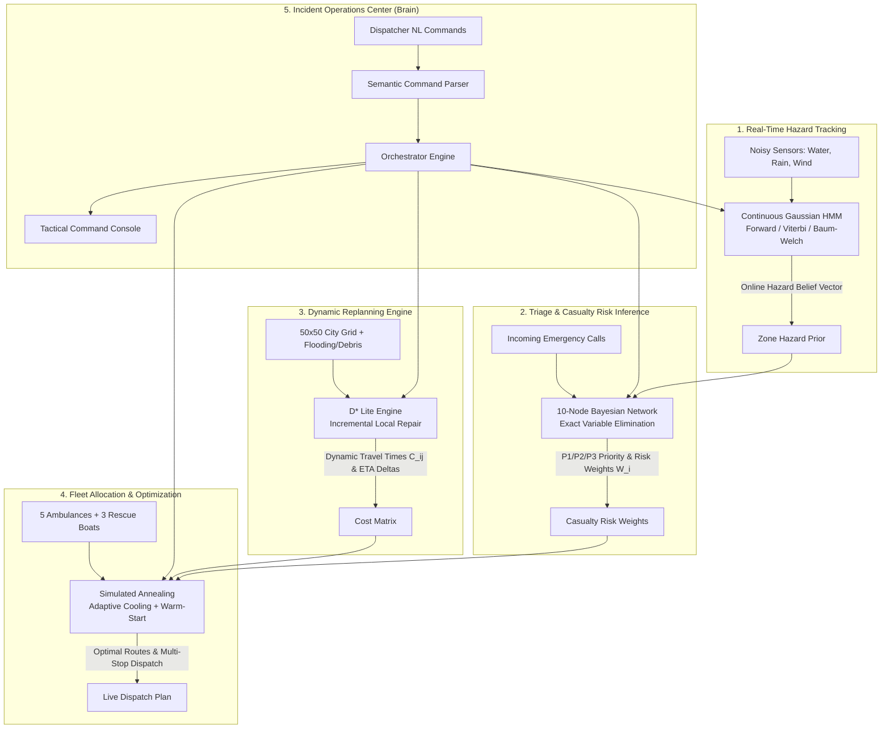

# ResQ-AI: System Architecture & Data Flow

## 1. High-Level Architecture Overview

ResQ-AI is designed as an event-driven multi-agent emergency logistics assistant. It couples four core AI algorithms implemented entirely from scratch in pure NumPy and standard Python:

---

## 2. Component Interaction & Pipeline Flow

### Pipeline Cycle:
1. **Sensor Update Loop ($T \to T+1$):**
   * Sensors stream continuous physical readings: $[\text{water\_level\_m}, \text{rainfall\_mmh}, \text{wind\_speed\_kmh}]$.
   * The **Gaussian HMM** evaluates emission probabilities and updates online belief state $P(X_t \mid \mathbf{y}_{1:t})$ via $O(N^2)$ scaled forward recursion.
   * If $P(\text{Critical}) + P(\text{Evacuate}) \ge 0.60$, an Escalation Alert is broadcast.

2. **Incoming Call Arrival:**
   * A call arrives with physical attributes (occupants, age of building, construction material, flood depth).
   * The **Bayesian Network** conditions on the caller evidence and the zone's HMM hazard state prior.
   * Exact inference via **Variable Elimination** computes:
     * $P(\text{StructuralCollapse} \mid e)$
     * $P(\text{HypothermiaRisk} \mid e)$
     * Priority level (`P1`, `P2`, or `P3`)
     * Continuous risk weight $W_i \in [1.0, 10.0]$
   * Transparent evidence attribution generates explainable rationale.

3. **Infrastructure Obstacle / Flooding Update:**
   * When an arterial road floods or a bridge fails, the **D\* Lite** router is notified.
   * Inconsistent vertices are added to the indexed priority queue.
   * D\* Lite repairs $g$ and $rhs$ values locally, rerouting vehicles in $O(k \log N)$ without global re-expansion.
   * ETA delta is calculated (e.g. *"+3.2 min via 4th Avenue"*).

4. **Fleet Allocation & Re-Optimization:**
   * The pairwise travel-time matrix $C_{ij}$ and risk weights $W_i$ feed the **Simulated Annealing** allocator.
   * Hard vehicle-type constraints (boats in water, ambulances on dry land) are strictly enforced in neighborhood proposals.
   * Soft capacity/fuel limits are penalized quadratically.
   * On dynamic events, **Warm-Start Re-Optimization** seeds the ongoing schedule and refines it via a fast reheat burst in $< 45\text{ ms}$.

5. **Natural Language Dispatch Interface:**
   * Commands like `"Dispatch rescue boat to Block C. Reports say Main Street is submerged."` are parsed into semantic entities and dispatched through the pipeline in $< 1.0\text{ s}$.
